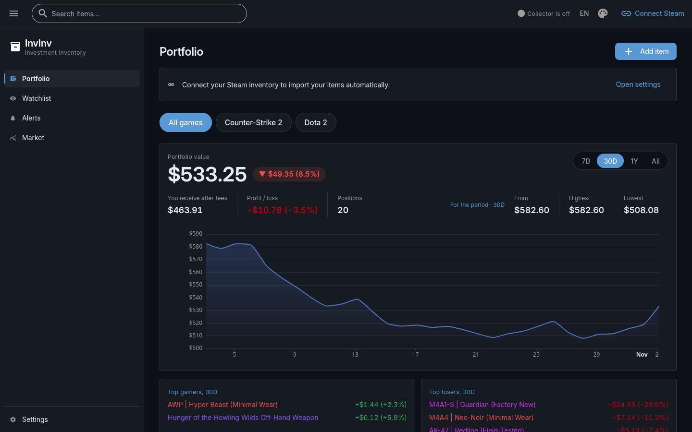
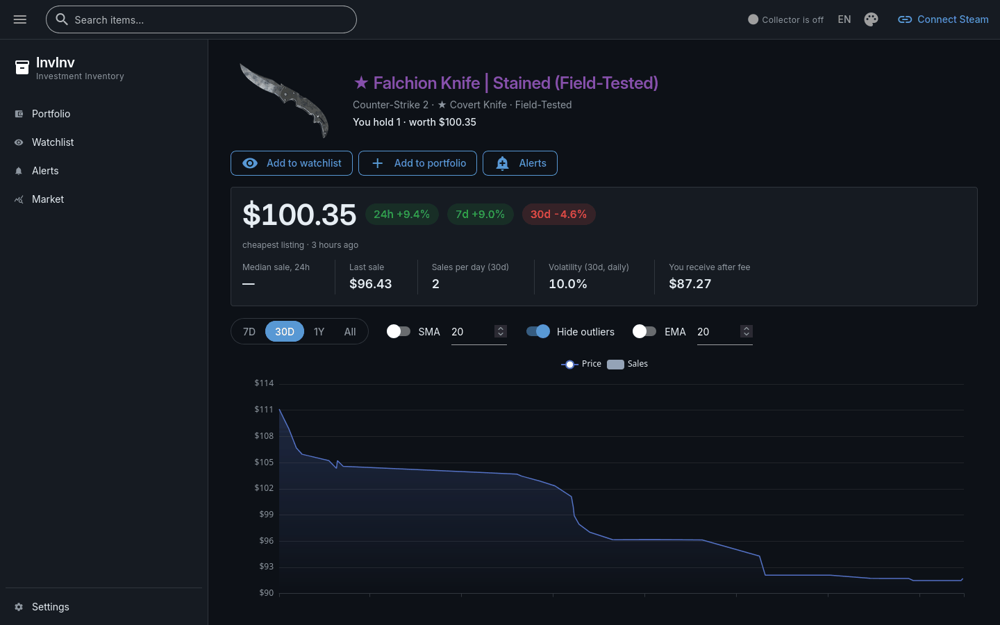
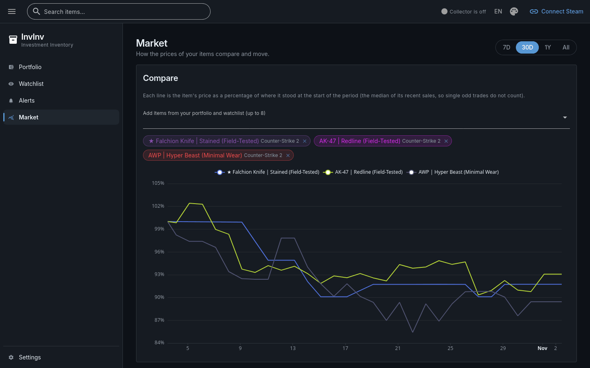

# InvInv — Steam Inventory Tracker

InvInv (Investment Inventory) is a self-hosted tracker for the value of the game items in your
Steam inventory, priced from the Steam Community Market.

> 🇷🇺 [Русская версия](README.ru.md)



## What it does

- **Portfolio** of your public Steam inventory, imported automatically, plus items you add by
  hand (such as storage unit contents) with an optional purchase price.
- **Value over time:** total value, value after Steam's fee, profit or loss and a chart of the
  portfolio's value, built from the full price history.
- **Item pages** with price and sales charts, changes, volatility and the order book.
- **Market:** compare items on one chart, rank your items, follow price indices.
- **Watchlist** and **alerts** on price levels or changes, in the app and in Telegram.
- English and Russian interface, dark and light themes.

No Steam login is needed; prices are shown in USD.

| Item page | Market |
|---|---|
|  |  |

## Quick start

Requirements: Docker with Compose.

```bash
cp .env.example .env    # then set POSTGRES_PASSWORD, INVINV_DATABASE_URL and INVINV_UI_STORAGE_SECRET
docker compose up --build -d
```

Open http://localhost:8080 and paste your Steam profile link on the Portfolio page. Your
inventory must be **public** (Steam → Profile → Edit Profile → Privacy settings → Inventory).

### Without Docker for the app

Requirements: Python 3.14 and [uv](https://docs.astral.sh/uv/). Postgres still runs in Docker.

```bash
docker compose up -d postgres
uv run invinv
```

InvInv has no login: it is meant for one person on their own computer and listens on
127.0.0.1 only. Do not expose it to a network you do not trust.

## Telegram alerts

Alerts always show up in InvInv. To also get them in Telegram, use a bot of your own:

1. In Telegram, message [@BotFather](https://t.me/BotFather), send `/newbot` and copy the
   bot's token.
2. In InvInv, open **Settings → Telegram alerts**, paste the token and save it.
3. Send any message to your bot, then press **Find my chat**.
4. Press **Send a test message** to check.

The token is stored encrypted in the database.

## Disclaimer

InvInv is not affiliated with, endorsed by, or connected to Valve Corporation or Steam.

## License

[MIT](LICENSE)
