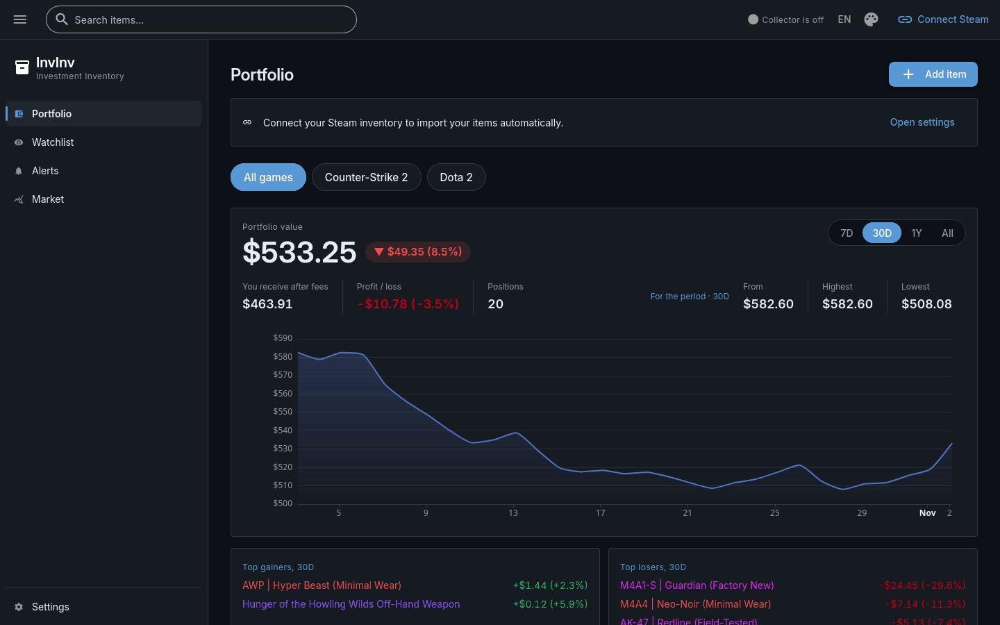
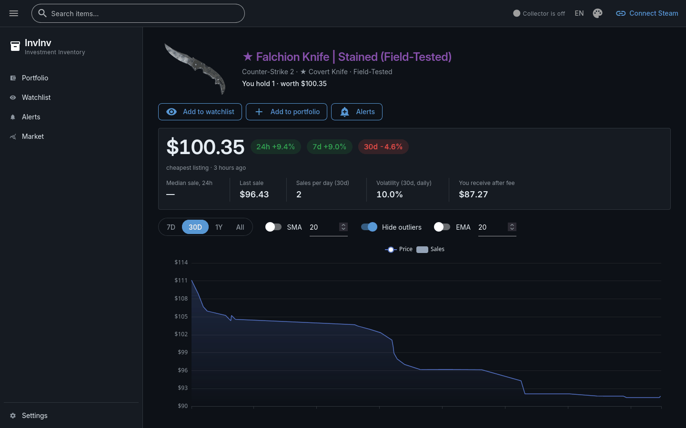
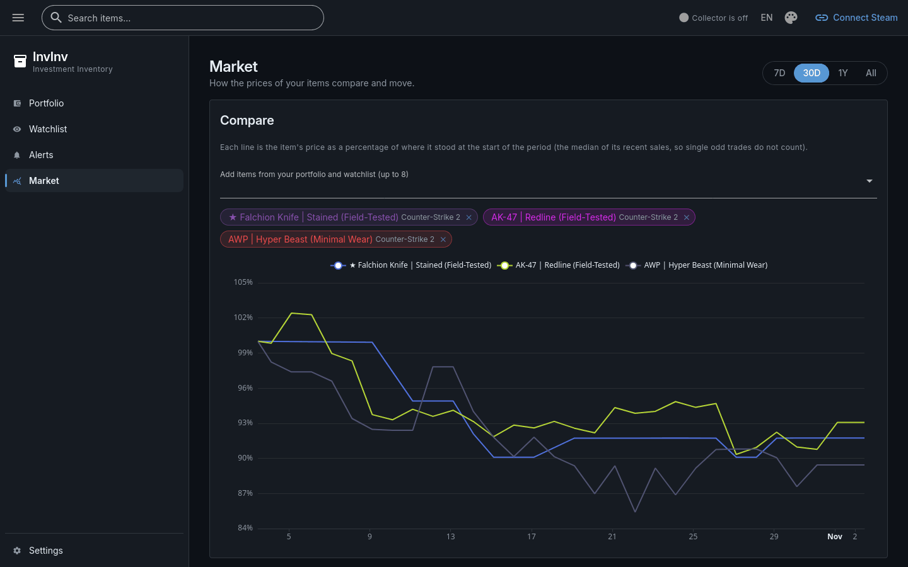

# InvInv — Steam Inventory Tracker

InvInv (Investment Inventory) — сервис для отслеживания стоимости игровых предметов в вашем
инвентаре Steam по ценам торговой площадки Steam. Запускается у себя.

> 🇬🇧 [English version](README.md)



## Что умеет

- **Портфель** из вашего открытого инвентаря Steam, импортируется автоматически, плюс
  предметы, добавленные вручную (например, содержимое хранилищ), с ценой покупки по желанию.
- **Стоимость во времени:** общая стоимость, сумма после комиссии Steam, прибыль или убыток и
  график стоимости портфеля, построенный по полной истории цен.
- **Страницы предметов** с графиками цены и продаж, изменениями, волатильностью и стаканом заявок.
- **Рынок:** сравнение предметов на одном графике, рейтинг ваших предметов, ценовые индексы.
- **Watchlist** и **алерты** на уровень цены или её изменение, в приложении и в Telegram.
- Интерфейс на английском и русском, тёмная и светлая темы.

Вход в Steam не нужен; цены показываются в USD.

| Страница предмета | Рынок |
|---|---|
|  |  |

## Быстрый старт

Нужен Docker с Compose.

```bash
cp .env.example .env    # затем задайте POSTGRES_PASSWORD, INVINV_DATABASE_URL и INVINV_UI_STORAGE_SECRET
docker compose up --build -d
```

Откройте http://localhost:8080 и вставьте ссылку на свой профиль Steam на странице Portfolio.
Инвентарь должен быть **открытым** (Steam → Профиль → Редактировать профиль → Приватность →
Инвентарь).

### Без Docker для самого приложения

Нужны Python 3.14 и [uv](https://docs.astral.sh/uv/). Postgres по-прежнему в Docker.

```bash
docker compose up -d postgres
uv run invinv
```

Входа на сайт нет: InvInv рассчитан на одного человека на своём компьютере и слушает только
127.0.0.1. Не открывайте его в сеть, которой не доверяете.

## Алерты в Telegram

Алерты всегда видны в самом InvInv. Чтобы они приходили ещё и в Telegram, нужен ваш собственный
бот:

1. Напишите в Telegram [@BotFather](https://t.me/BotFather), отправьте `/newbot` и скопируйте
   токен бота.
2. В InvInv откройте **Settings → Telegram alerts**, вставьте токен и сохраните.
3. Отправьте своему боту любое сообщение и нажмите **Find my chat**.
4. Нажмите **Send a test message**, чтобы проверить.

Токен хранится в базе в зашифрованном виде.

## Отказ от ответственности

InvInv не связан с Valve Corporation и Steam и не одобрен ими.

## Лицензия

[MIT](LICENSE)
